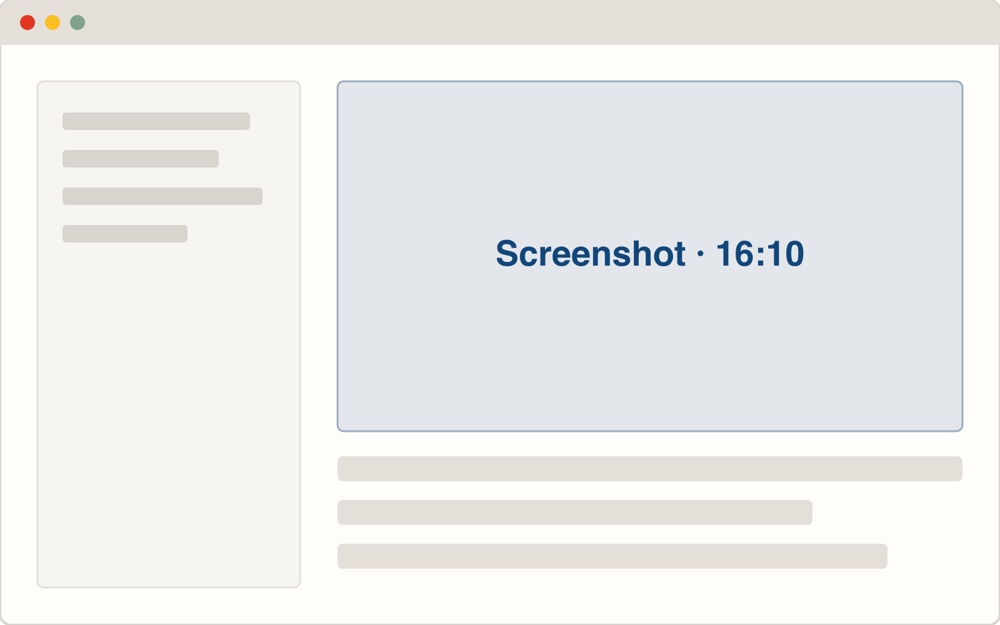
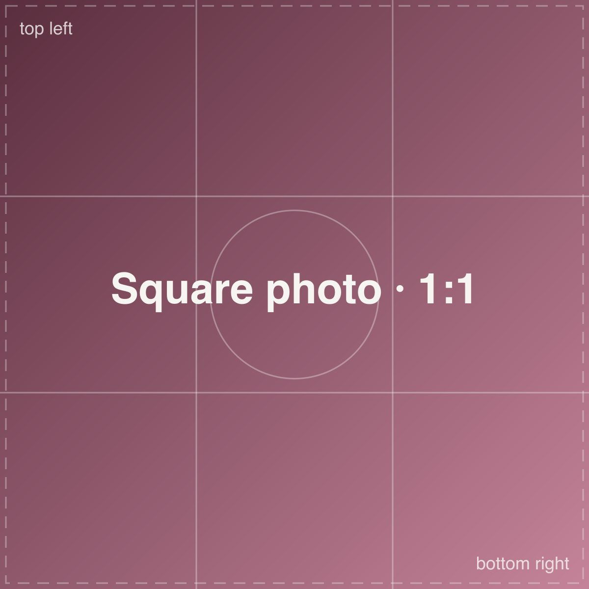
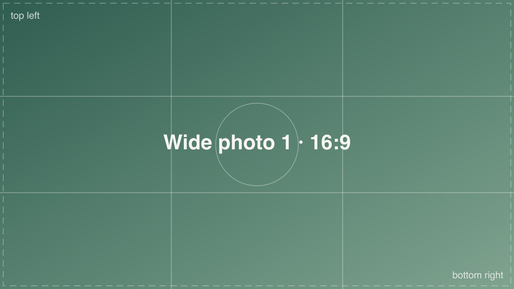
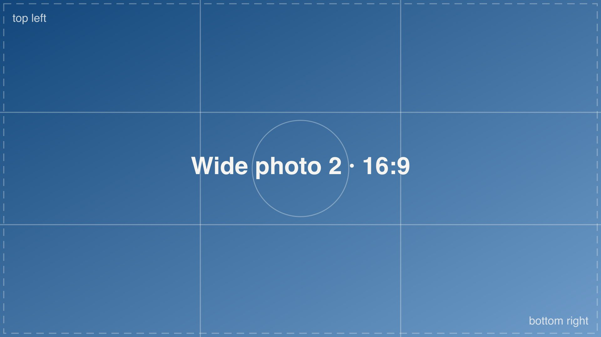
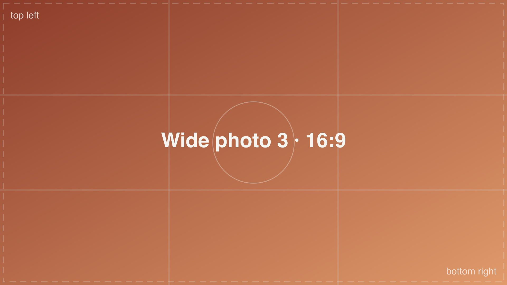
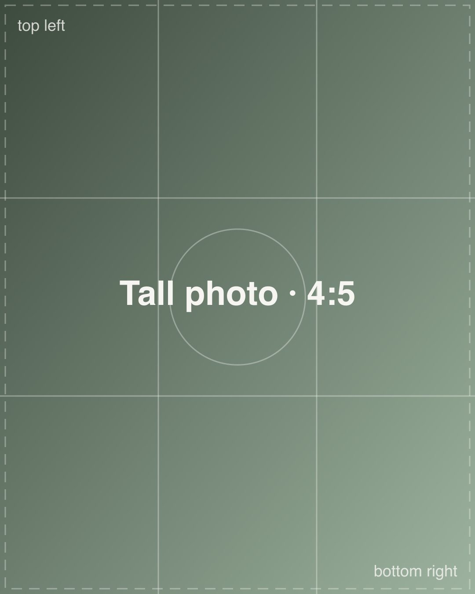
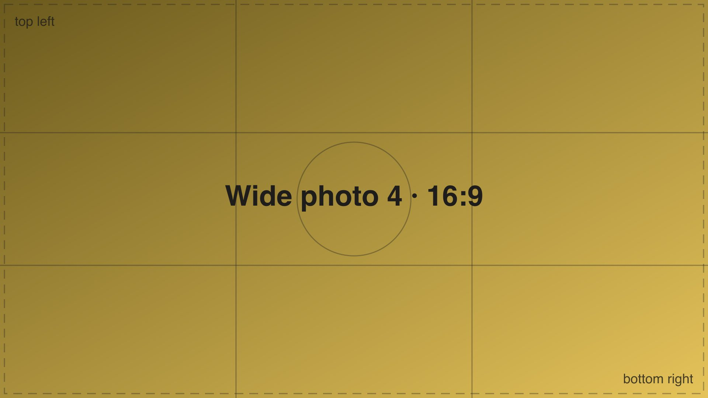
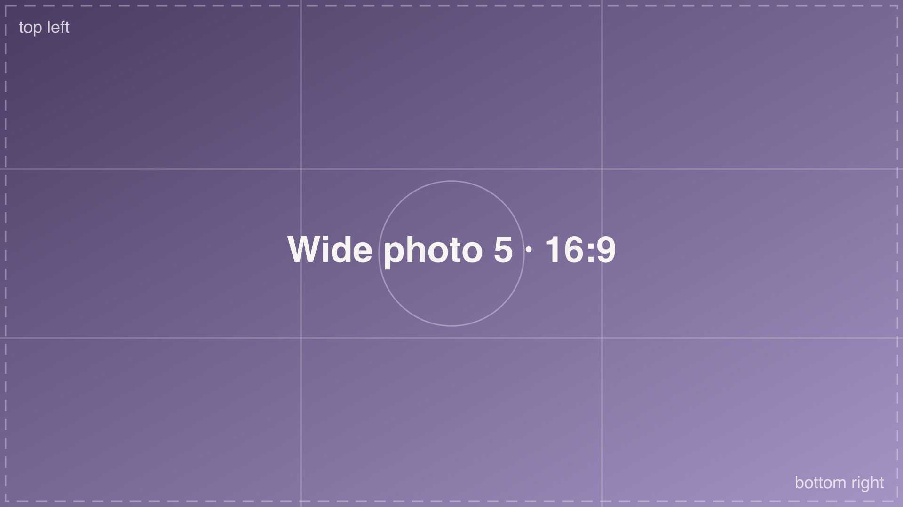
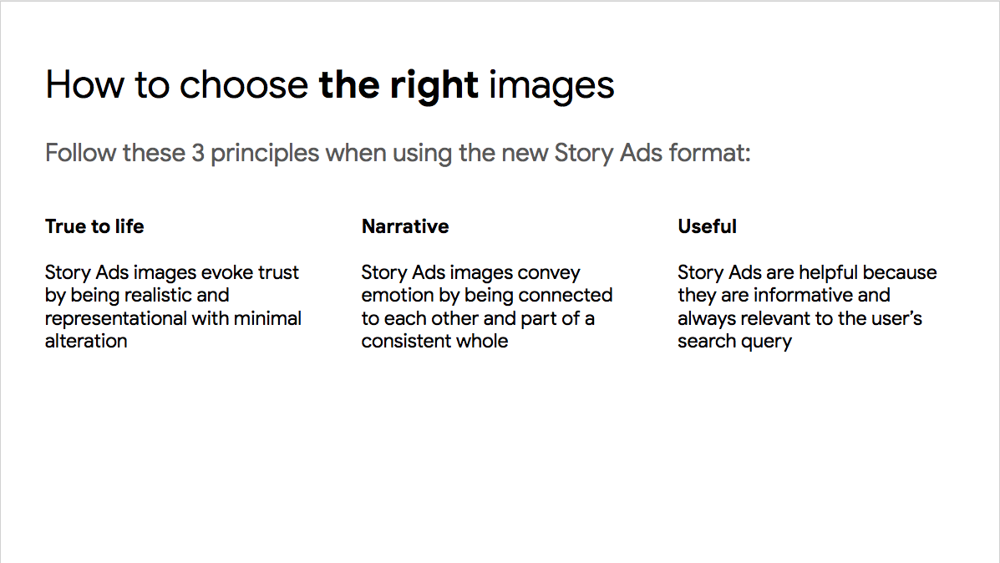
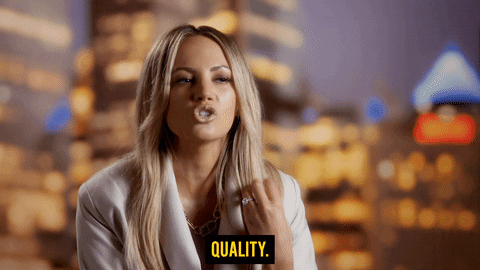

---
# Every front matter option. All are optional.
# A blank option uses its default.

# The browser tab title. Blank: "Deck".
title: Chardonnay

# The page's meta description. Blank: none.
description: Every example slide from the Venge FYI Figma file, in order.

# A small label at the top centre of every slide except the first.
# A slide's own #### replaces it; a blank #### hides it. Blank: none.
eyebrow: Venge FYI

# The colour for bullets, links, the quote mark and charts.
# Quote it: '#12467A'. Blank: the theme's --deck-theme-1.
accent:

# A built-in theme (dark, signal) or a path to your own CSS file.
# Blank: the default look.
theme:

# Chart libraries for charts written as JSON: chartjs, echarts.
# CSV charts get chartjs on their own. Blank: none.
charts:

# Show each slide's markdown in a panel beside it. Press M to hide it.
# Blank: false.
source:

# Number every slide in the bottom right corner. Blank: false.
page-numbering: true
---

# Chardonnay

---

# Chardonnay

## An example deck

---

#### Venge FYI

# Every slide type

## One example of each layout

### November 2026

---

# One paragraph

A slide with only text sits in the middle.
It can hold one or two short paragraphs.

---

#### Eyebrow

# A short list

- List items stay left-aligned 
- The list sits in the middle <!-- .element: class="fragment" -->
- Keep it to three or four items <!-- .element: class="fragment" -->

---

> Write the words first. Then add the
> pictures they need.

### Sample quote

---

<!-- .slide: class="dark" data-background-color="blue" -->

# Part 1: Text

---

<!-- .slide: class="dark" data-background-image="assets/street.jpg"
     data-background-color="#000" data-background-opacity="0.5" -->

# Text on a photo

---

## Text beside a picture

Text takes a third and the picture two thirds.



---


## Picture first

Write the picture first to put it on the left.

---

####

## A short list

- Short points work here
- Keep them brief



---

## Two pictures

They share the two thirds and stack.




---

<!-- .slide: class="split" -->

## Three pictures
Two on top, one centred under them.

## heading

 
 


---

## Slides made each quarter

A chart is a picture too.


Sample data, not real numbers.

---

## Bleed

The photo is cropped and runs off the edge.

<!-- .cell: class="bleed" -->


---


---


---


---




---




---


---


Workshop, October 2026.

---


Six photos, one caption.

---

<!-- .cell: class="fill" -->


---

<!-- .cell: class="bleed" -->


---

<!-- .cell: class="stack" -->

 <!-- .element: class="fragment" -->

---

<!-- .slide: class="prose" -->

## Prose with a list

Prose is for more than a few sentences. The text
sits in one column and lines up on the left.

- Use it for steps or notes
- It can hold lists, tables and code
- It is the only type that scrolls

---

<!-- .slide: class="prose" -->

## Prose with a table

A table works well when you compare a few things.

| You write | You get |
| --- | --- |
| Text alone | headline |
| Text and pictures | figure |
| Pictures alone | image |

---

<!-- .slide: class="prose" -->

## Prose with code

Code blocks wrap long lines, so nothing runs off the slide.

```markdown
## A heading

A short line of text.


```

---

## Taking turns

Text and pictures that take turns more than once
read top to bottom.


So this slide is a prose slide.

---

<!-- .slide: class="split" -->

## Before

Each person builds slides their own way,
so no two decks look the same.

## After

- Everyone writes Markdown
- Text and images go in the right place
- The preview shows each slide as you type

---

<!-- .slide: class="split" -->

## What changes

### Before

Each person builds slides their own way,
so no two decks look the same.

### After

- Everyone writes Markdown
- Text and images go in the right place
- The preview shows each slide as you type

---

<!-- .slide: class="split dark" -->

## Light

The usual look, on the page colour.

## Dark

The same layout with `dark`.

---

<!-- .slide: class="cards" -->

## One idea
Each slide makes one point.

## Right pictures
Each picture earns its place.

---

<!-- .slide: class="cards" -->

# Check these before you share a deck

## One idea
Each slide makes one point.
new idea

## Right pictures
Each picture earns its place.

## Fits the frame
Nothing runs off the edge.

---

<!-- .slide: class="cards" -->

## Four cards

### One idea
Each slide makes one point.

### Right pictures
Each picture earns its place.

### Fits the frame
Nothing runs off the edge.

### Short
One or two lines is enough.

---

<!-- .slide: class="cards" -->

## Five cards

### One idea
Each slide makes one point.

### Right pictures
Each picture earns its place.

### Fits the frame
Nothing runs off the edge.

### Short
One or two lines is enough.

### Clear
The heading says the main idea.

---

<!-- .slide: class="cards" -->

## Six cards

### One idea
Each slide makes one point.

### Right pictures
Each picture earns its place.

### Fits the frame
Nothing runs off the edge.

### Short
One or two lines is enough.

### Clear
The heading says the main idea.

### Last
This is the last one.

---

<!-- .slide: class="columns" -->

## Who does what

### Writers

Write the slides in Markdown.

### Designers

Set the colours and sizes in a theme.

---

<!-- .slide: class="columns" -->

## Who does what

### Writers

Write the slides in Markdown.

### Designers

Set the colours and sizes in a theme.

### Developers

Keep the code working.

---

<!-- .slide: class="columns" -->

## Who does what

### Writers

Write the slides in Markdown.

### Designers

Set the colours and sizes in a theme.

### Developers

Keep the code working.

### Readers

Read the deck anywhere.
