<!-- .slide: class="dark" data-background-color="#012b30" -->

# Coming into focus mode

Zendesk

---

## Zendesk

At Zendesk I worked on a globally distributed team of content designers who are each embedded in specific product areas or areas of focus.

My area of focus was the agent experience.

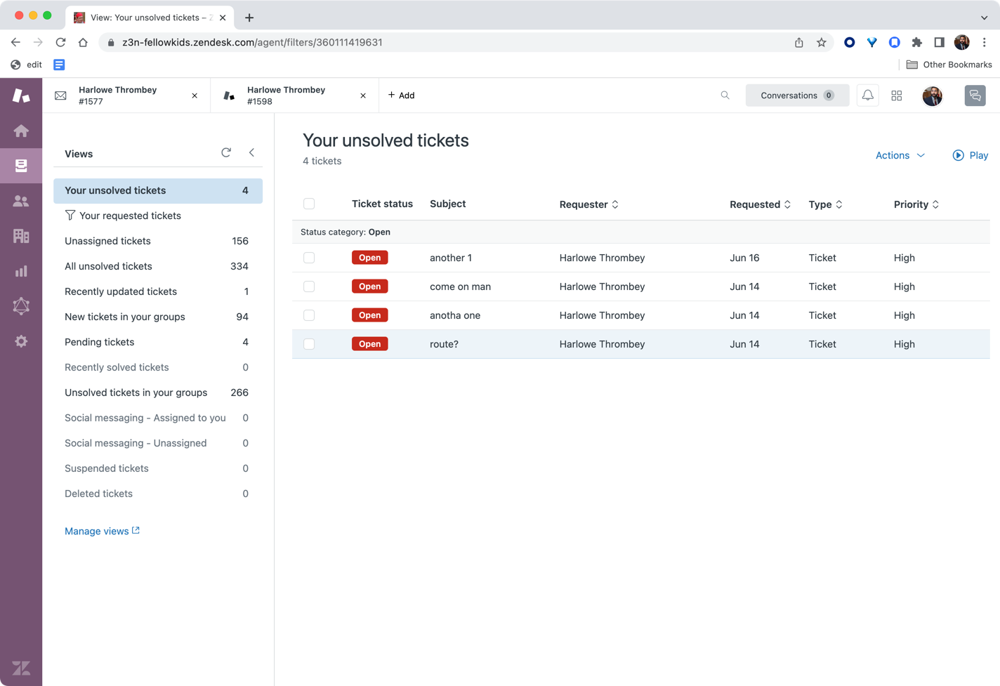

---

<!-- .element: class="image stack" -->

# Moonlighting

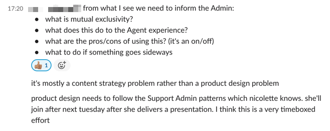
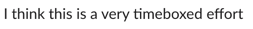 <!-- .element: class="fragment" -->

---

Focus mode <!-- .element: class="eyebrow" -->

## A “timeboxed effort” indeed 

Because this was a side hustle, I could only meet with the Dublin-based team once per week.

The entire thing took 12 weeks from soup to nuts. This is that process.

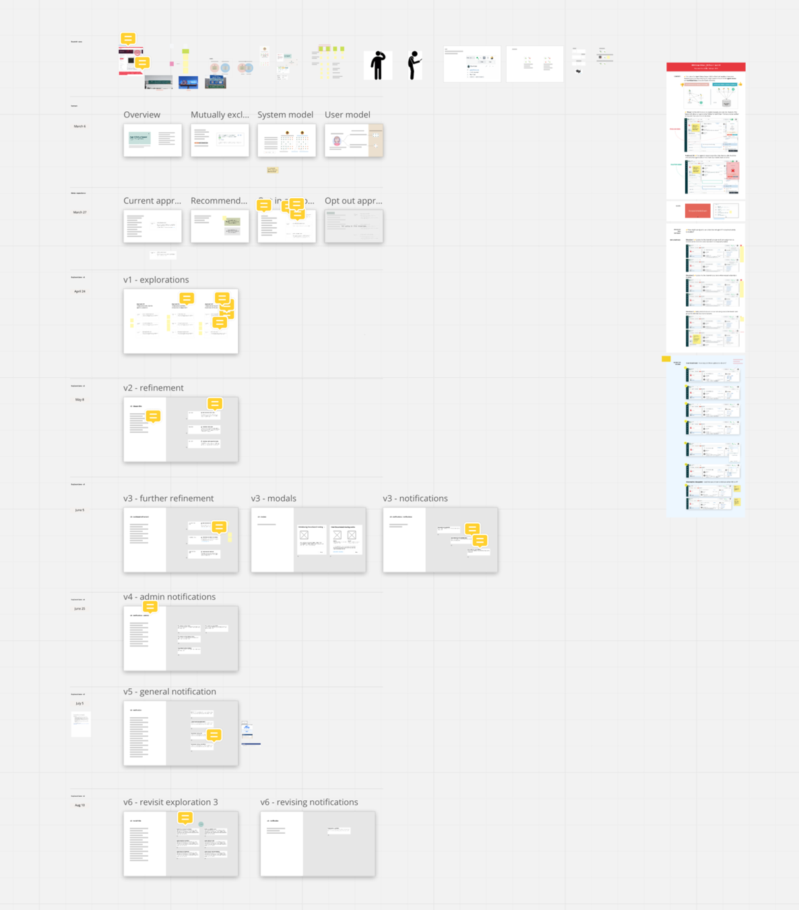
This took 12 weeks.

---

<!-- .slide: class="dark split" data-background-color="#012b30" -->

## Mutually exclusive channels
## Focus mode <!-- .element: class="fragment" -->

---

# Who are we talking about?

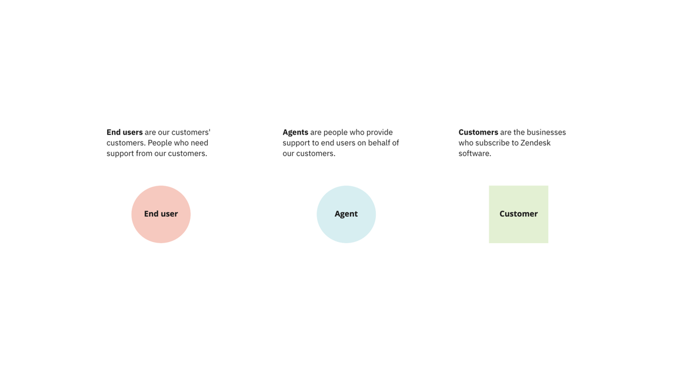

---

# What are live channels?

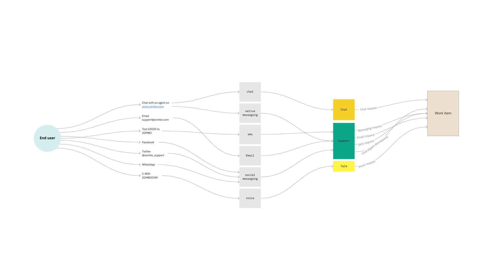

---

# Agents struggle with live channels

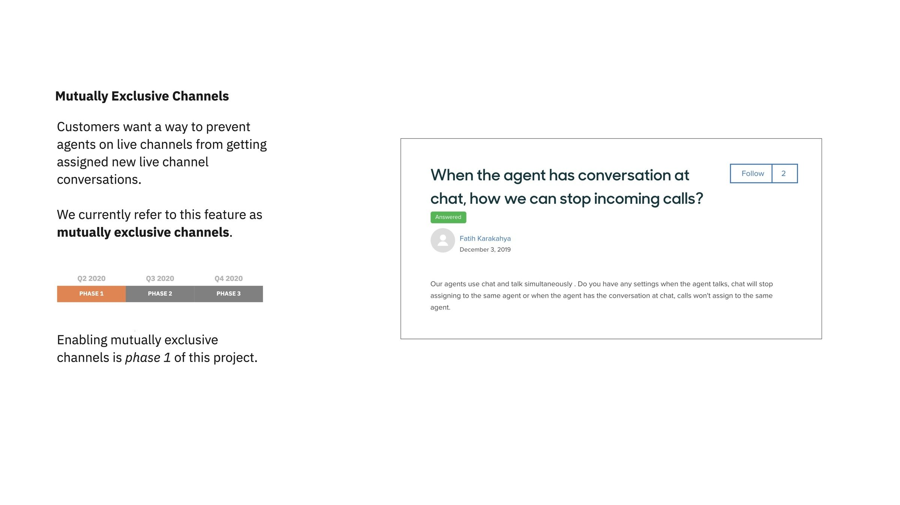

---

## What is mutual exclusivity?

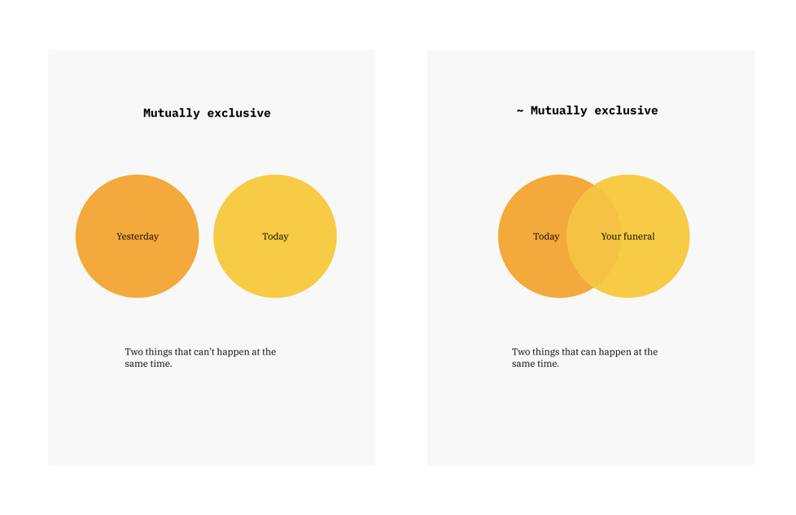

---

## A look under the hood

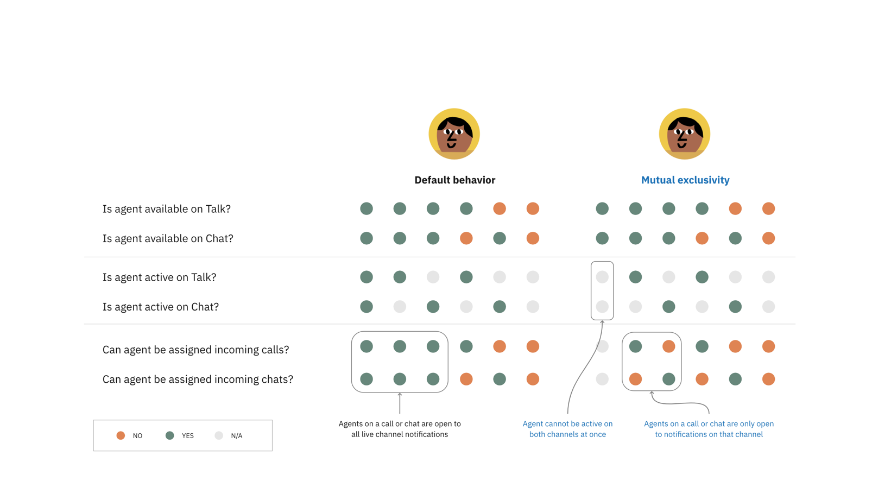

---

## The user's point of view

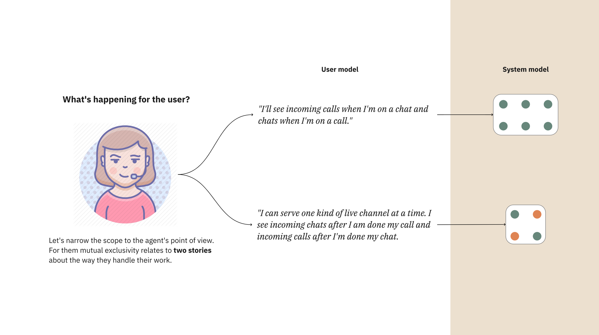

---

<!-- .slide: class="split" -->

## Decisions, decisions

I wanted to make sure my product partners agreed with my approach. Rather than proposing a single name, I used a “fork in the road” check-in — presenting two directions and letting the team choose. This is a technique I use to build alignment without it feeling like a mandate.

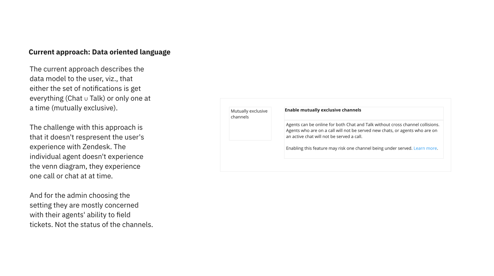
Data-oriented language

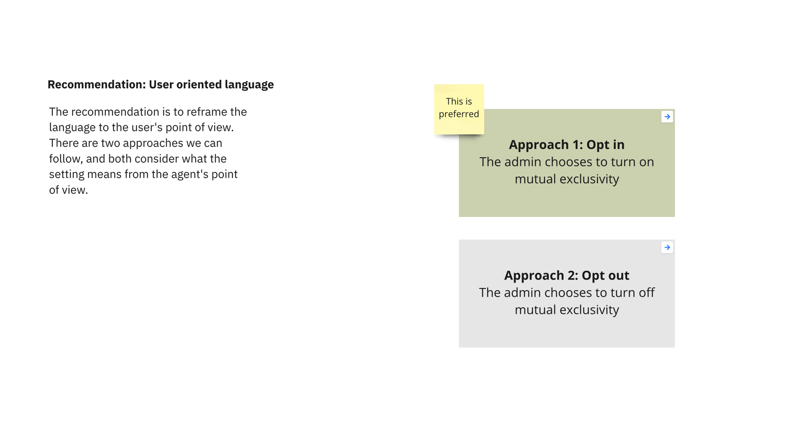
User-oriented language

---

<!-- .slide: class="dark" data-background-image="assets/fork-in-the-road.gif" data-background-color="#000" data-background-opacity="0.45" -->

Key learning <!-- .element: class="eyebrow" -->

## Check in with your product partners at every “fork in the road” before you move too far ahead.

---

<!-- .slide: class="dark" data-background-color="#012b30" -->

# What do we call this thing?

---

## Three approaches

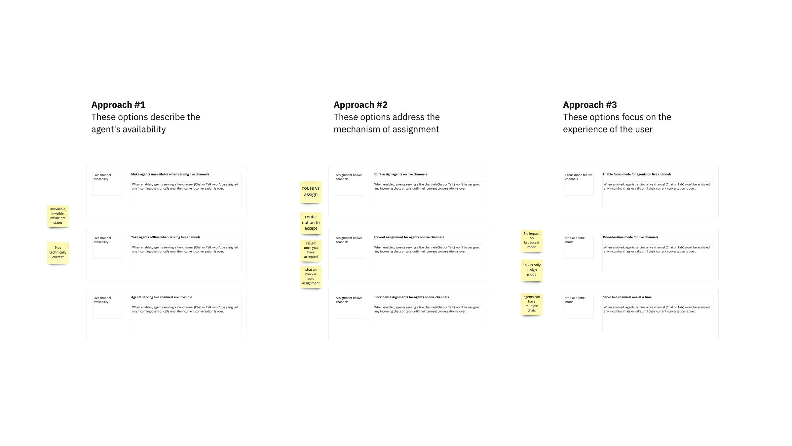
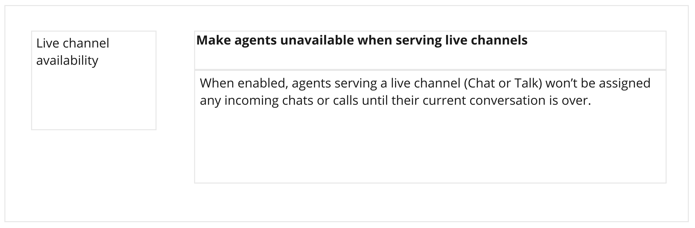
Setting name, heading, description

---

## Naming the approaches helps partners

---

## Deeper dive

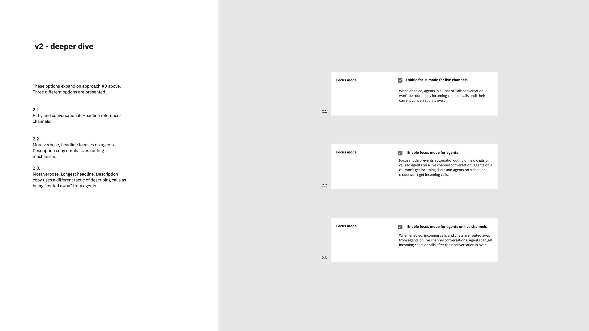
Named approaches

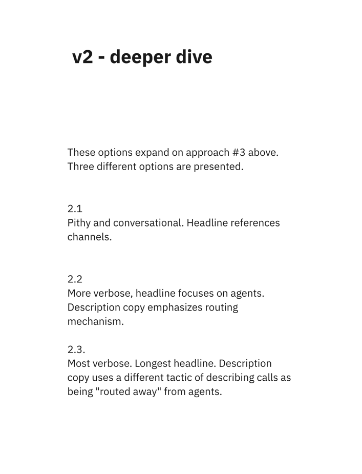
In situ

---

## How else will this language be used?

Including explorations of onboarding modals.

Different contexts can help stress-test your language.

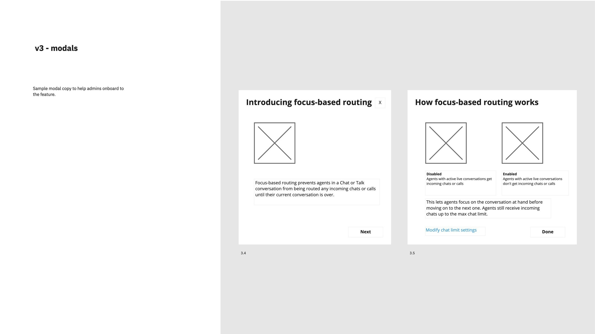

---

<!-- .slide: class="dark" data-background-color="#012b30" -->

# The entire process was well documented

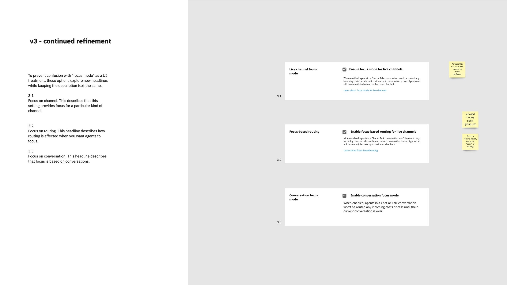

---

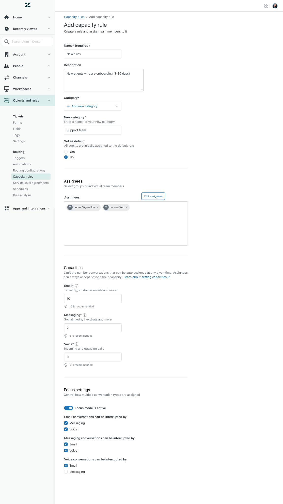

## Final design

A sneak peek at the final setting for focus mode on the settings page.
