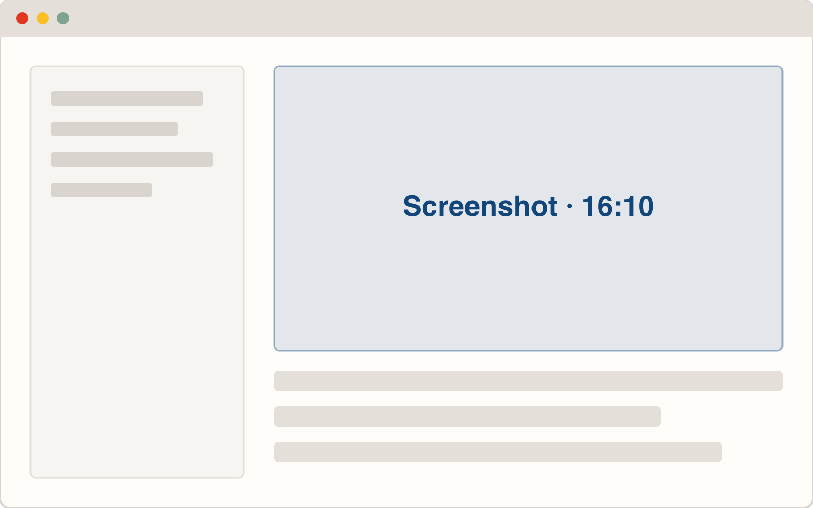
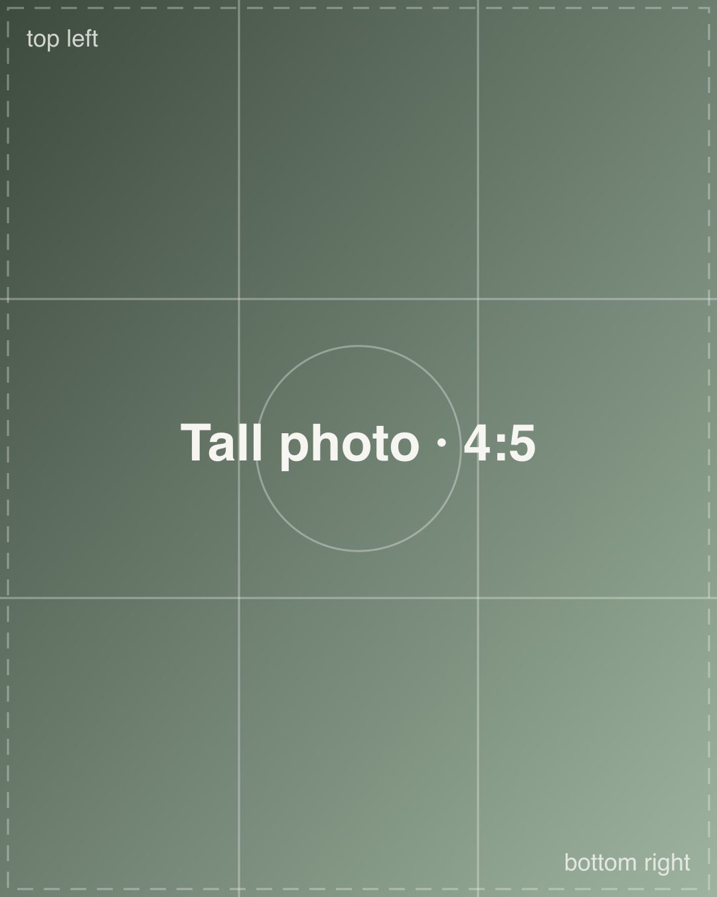
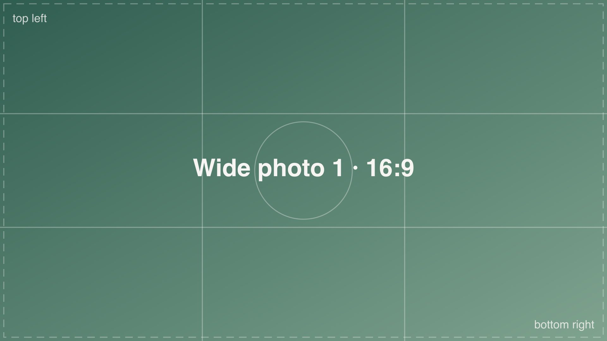
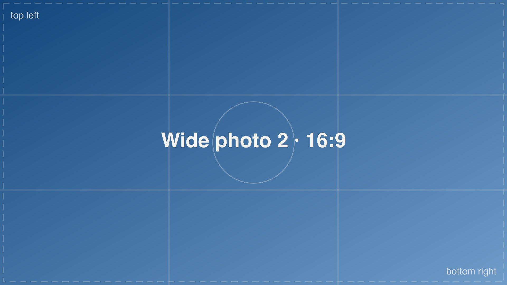
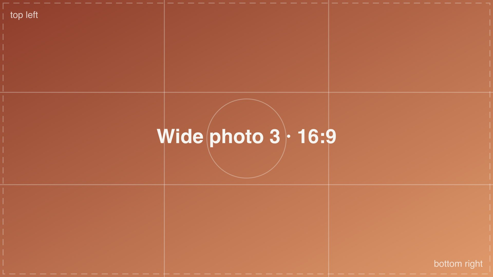
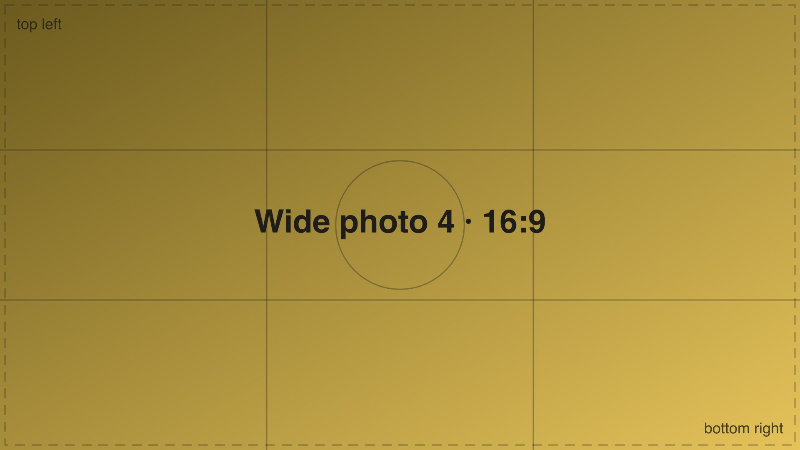
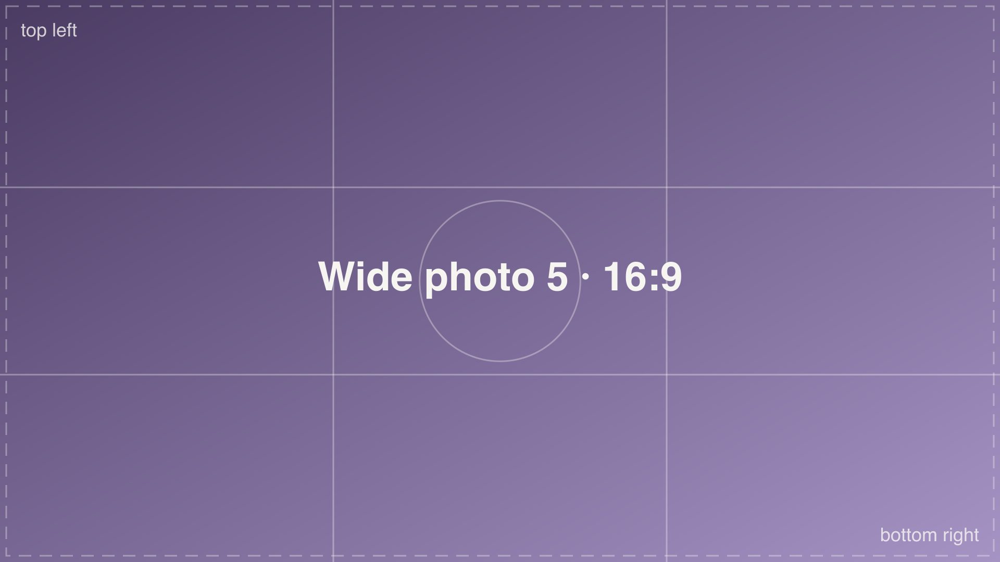
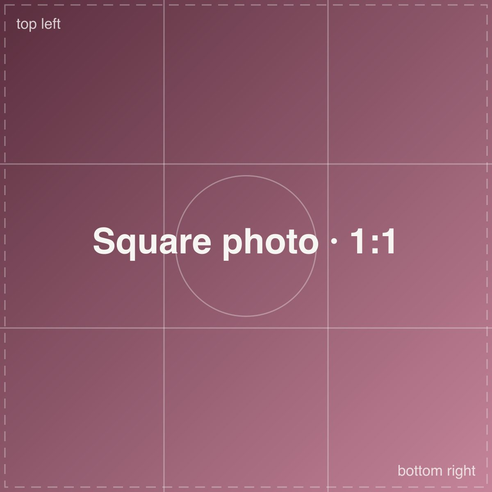
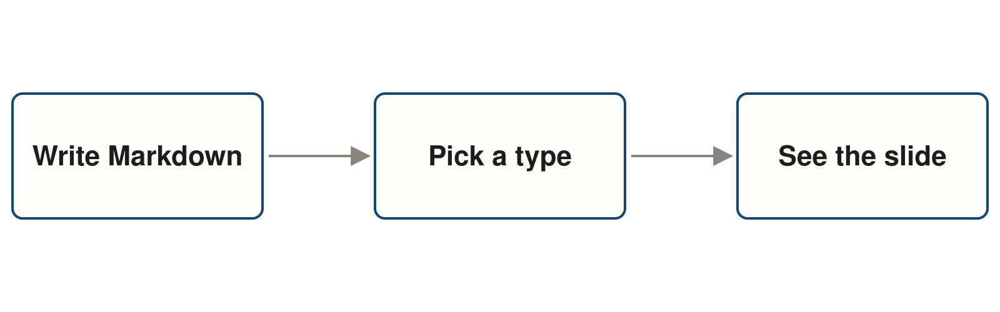

---
# Every front matter option. All are optional.
# A blank option uses its default.

# The browser tab title.
title: How Decks Works

# The page's meta description.
description: Showing how every slide in the system works.

# The colour for bullets, links, the quote mark and charts.
# Blank uses the theme's --deck-accent. Quote colours: '#12467A'.
accent:

# A built-in theme name (dark, signal), or a path to your own CSS file.
# Blank uses the default look.
theme: 

# Chart libraries, for charts written as JSON: chartjs, echarts. CSV charts don't need this.
charts: ["chartjs"]

# Show each slide's Markdown in a panel beside it. Press M to hide it.
source: true
---

<!-- .slide: class="big" -->

#### Venge-FYI

# Easy Markdown Decks

I want prose here

## A revenge project

### November 2026

---

<!-- .slide: class="big" -->

# Cover Slide (#)

### This line is called a chin (###)

---

<!-- .slide: class="big dark" -->

#### #### Use h4 for eyebrows

# # Headings are big

## ## h2 for subheadings

### ### Guess what this is

---

<!-- .slide: class="big dark" -->

# Part 1: Big

---

#### Big

# A short statement

## this is smaller

### The chin goes at the bottom.

---

# One paragraph

This slide has no type line, so it is a big slide. A big slide can hold one or two short paragraphs.

---

# Two paragraphs

Keep each paragraph short. Together they should be about 40 words.

If you need more than that, use a prose slide instead.

---

# A short list

- List items stay left-aligned
- The list sits in the middle of the slide
- Keep it to three or four items

---

> Write the words first. Then pick the slide type that fits them.

### Sample quote

---

<!-- .slide: class="dark" -->

# A dark big slide

### dark

---

<!-- .slide: class="prose" -->

## Prose with a list

Prose is for more than a few sentences. The text sits in one column and lines up on the left.

- Use it for steps or notes
- It can hold lists, tables and code
- It is the only type that scrolls  
  - Lists look like this
    - Level down
      - Level down again

You can add more text here.

---

<!-- .slide: class="prose" -->

## Prose with a table

A table on prose works well when you need to compare a few things.

| Type | Use it for | Another column |
| --- | --- | --- |
| big | One short point | More text |
| prose | Longer text | More text |
| figure | Text about one picture | More text |
| image | Photos | More text |

---

<!-- .slide: class="prose" -->

## Prose with code

Code blocks wrap long lines, so nothing runs off the slide.

```markdown
<!-- .slide: class="figure" -->

## A heading

A short line of text.



Lorem ipsum dolor sit amet consectetur adipiscing elit. Quisque faucibus ex sapien vitae pellentesque sem placerat. In id cursus mi pretium tellus duis convallis. Tempus leo eu aenean sed diam urna tempor. Pulvinar vivamus fringilla lacus nec metus bibendum egestas. Iaculis massa nisl malesuada lacinia integer nunc posuere. Ut hendrerit semper vel class aptent taciti sociosqu. Ad litora torquent per conubia nostra inceptos himenaeos.

```

---

<!-- .slide: class="prose" -->

## Prose that runs long

This slide has more text than fits on the screen. Scroll down to read the rest. A fade at the bottom shows there is more. Each paragraph here is just filler so the slide runs long. It does not say anything new. Prose is the only slide type that is allowed to scroll. On every other type, content that does not fit runs off the slide.

If a slide feels too long, try to split it into two slides. Most of the time, two short slides are easier to follow than one long one.

**This is bold text.**

---

<!-- .slide: class="figure" -->

## Figure with a screenshot

Use a figure when you need a few lines of text to explain one picture.


---

<!-- .slide: class="figure is-reverse" -->

## Figure, reversed

Add `is-reverse` to put the picture on the left.


---

<!-- .slide: class="figure" -->

## Figure with a tall photo

The picture is never cropped. A tall photo stays tall.

- Short points work here too
- Keep them brief



---

<!-- .slide: class="figure" -->

## Figure with a chart

A chart from a CSV file can sit beside the text too.


---

<!-- .slide: class="image" -->



---

<!-- .slide: class="image" -->




---

<!-- .slide: class="image" -->




---

<!-- .slide: class="image" -->




---

<!-- .slide: class="image" -->




---

<!-- .slide: class="image" -->




---

<!-- .slide: class="image" -->

#### Workshop, October 2026


---

<!-- .slide: class="image" -->

#### Two photos with a label


---

<!-- .slide: class="image overlay" -->

# Part 2: Images


---

<!-- .slide: class="image overlay" -->

# Heading over three photos


---

<!-- .slide: class="image" -->


---

<!-- .slide: class="split" -->

## Before

Each person builds slides their own way, so no two decks look the same.

## After

- Everyone picks from the same nine types
- Text and images go in the right place on their own
- A check finds mistakes before the deck goes live

---

<!-- .slide: class="split" -->

## What stays

- The words you write
- The order of your slides
- Your speaker notes


## What changes

- How each slide looks
- Where things sit
- The colours and type

---

<!-- .slide: class="split dark" -->

## Light

The usual look, on the page colour.

## Dark

The same layout with `dark`.

---

<!-- .slide: class="cards" -->

## One card

### Only one
A single card still shows. It just looks lonely.

---

<!-- .slide: class="cards" -->

## First
Two cards sit side by side.

## Second
With only `##` headings, each one starts a card and there is no title.

---

<!-- .slide: class="cards" -->

## Check these before you share a deck

### One idea
Each slide makes one point.

### Right type
The slide type fits the content.

### Fits the frame
Nothing runs off the edge.


---

<!-- .slide: class="cards" -->

## Four cards

### One
Four cards make two rows of two.

### Two
Keep each card short.

### Three
One or two lines is enough.

### Four
The heading says the main idea.

---

<!-- .slide: class="cards" -->

## Five cards

### One
Five cards go three across.

### Two
The last row has two.

### Three
Keep them short.

### Four
Start with a heading.

### Five
This is the last one.

---

<!-- .slide: class="cards" -->

## Six cards

### One
Six is the most cards. 

### Two
They make two rows.

### Three
 three in each row. three in each row.three in each row.three in each row.three in each row.three in each row.three in each row.three in each row.

- Subbullet
- Subbullet

### Four
Keep them short.

### Five
Start with a heading.

### Six
More than six? Split the slide. more than six? Split the slide. more than six? Split the slide.

---

<!-- .slide: class="cards" -->

### One
Six is the most cards.


### Two
They make two rows.

### Three
Three in each row.

- Subbullet
- Subbullet

### Four
Keep them short.

### Five
Start with a label.

### Six
More than six? Split the slide.

---

<!-- .slide: class="columns" -->

## Two columns

### Writers

Write the slides in Markdown and pick a type for each one.

### Designers

Design the slide types in Figma and set the colours and sizes.

---

<!-- .slide: class="columns" -->

## Who does what

### Writers

Write the slides in Markdown and pick a type for each one.

### Designers

Design the slide types in Figma and set the colours and sizes.

### Developers

Keep the code working and run the check on every deck.

---

<!-- .slide: class="columns" -->

## Four columns

### Write

Put your words in a Markdown file.

### Pick

Choose a type for each slide.

### Check

Look at each slide in the browser.

### Share

Send the link when it looks right.

---

<!-- .slide: class="chart" -->

## Slides made each quarter


Sample data, not real numbers.

---

<!-- .slide: class="chart" -->

## Two teams, by month


Sample data, not real numbers.

---

<!-- .slide: class="chart" -->

## The same data as bars


---

<!-- .slide: class="chart" -->

## Stacked and sideways


---

<!-- .slide: class="chart" -->

## Slides by type


Sample data, not real numbers.

---

<!-- .slide: class="chart" -->

## A diagram



---

<!-- .slide: class="chart" -->

## A chart written as JSON

<canvas data-chart="chartjs" data-config='{"type":"bar","data":{"labels":["Q1","Q2","Q3","Q4"],"datasets":[{"data":[12,18,9,27]}]},"options":{"plugins":{"legend":{"display":false}}}}'></canvas>

Sample data, not real numbers.

---

# Questions?
