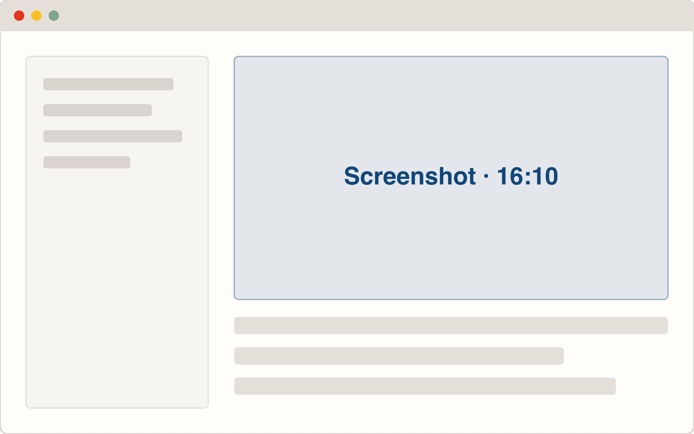
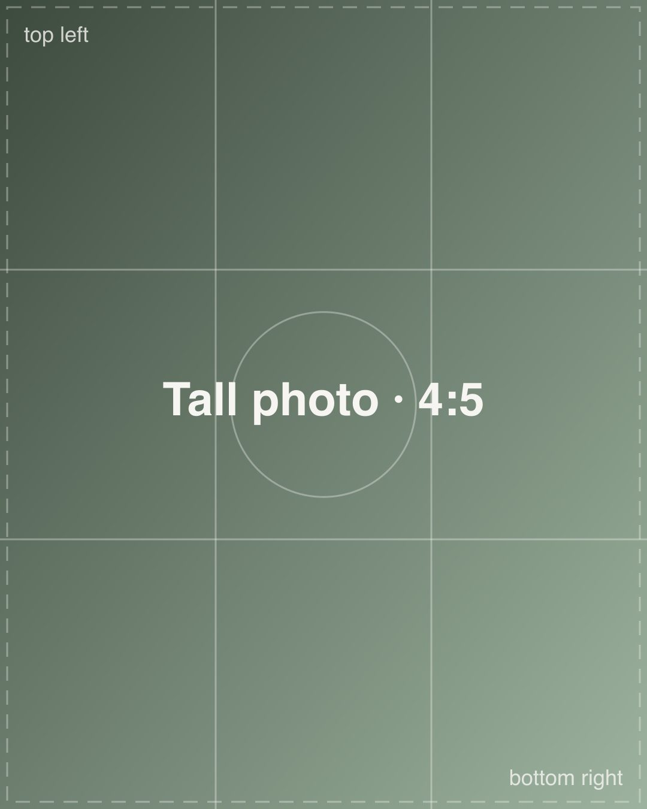
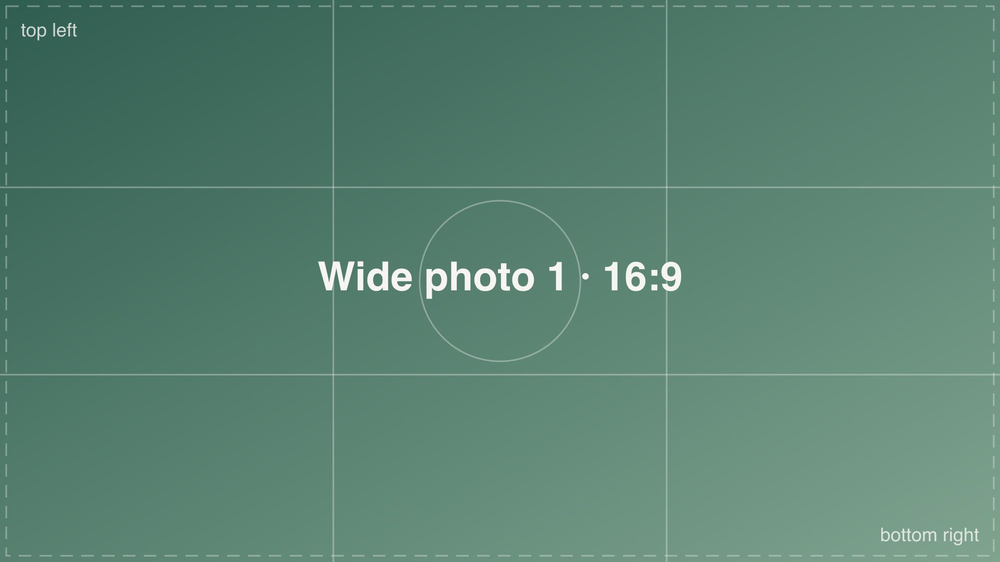
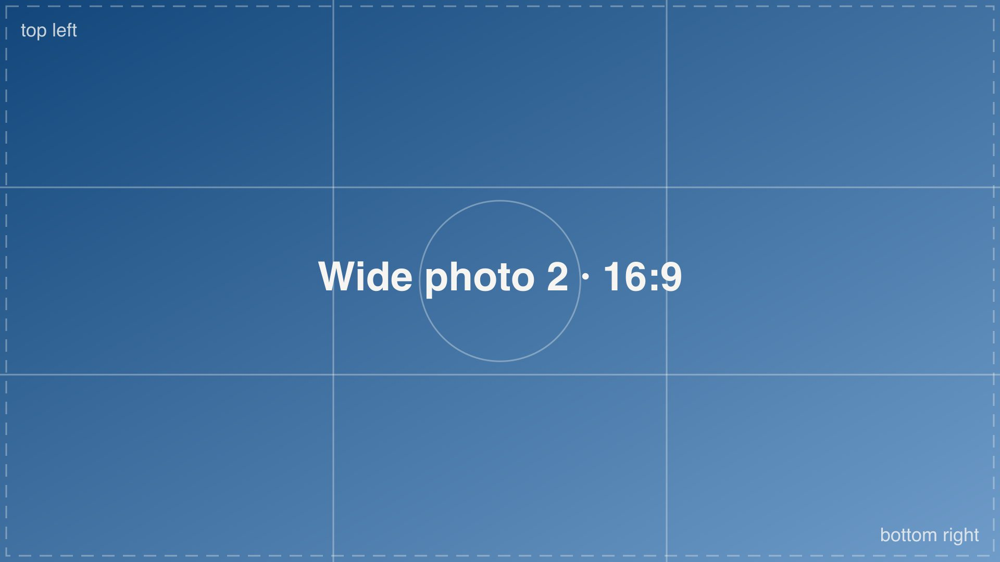
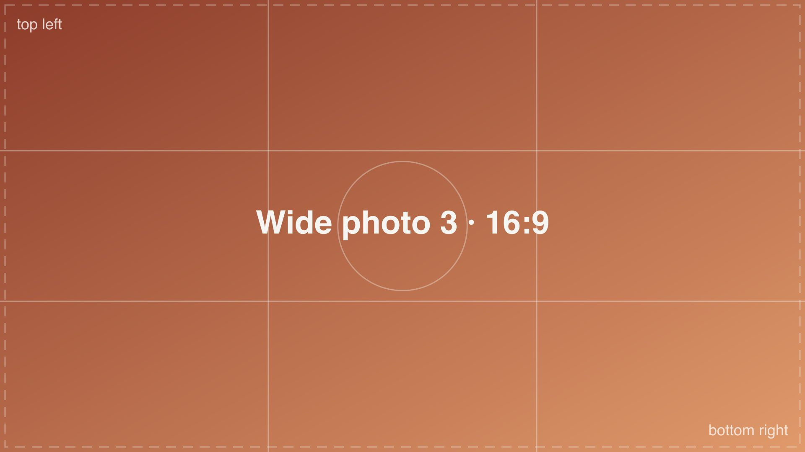
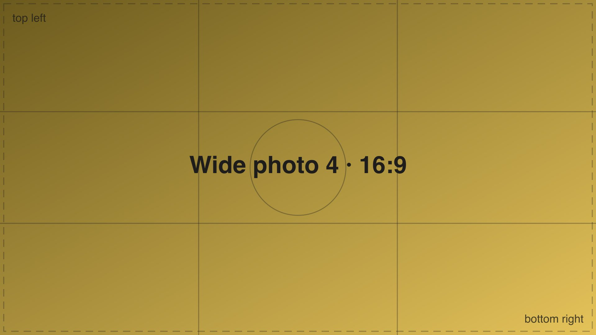
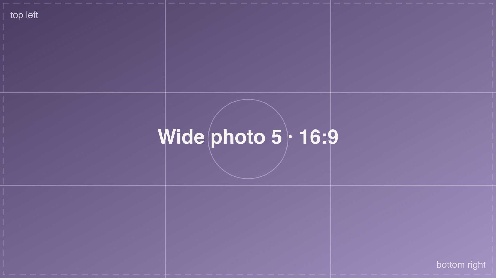
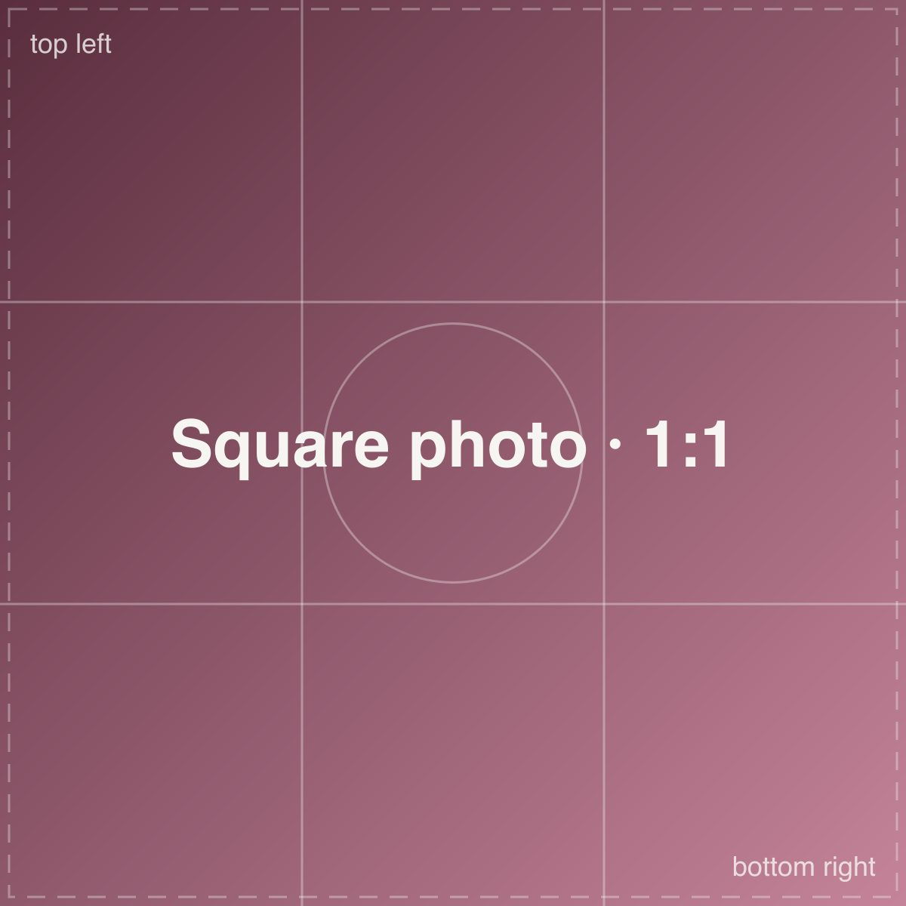
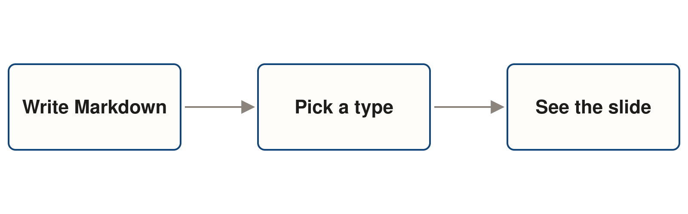

---
# Every front matter option. All are optional.
# A blank option uses its default.

# The browser tab title.
title: How Decks Works

# The page's meta description.
description: Showing how every slide in the system works.

# The colour for links, the quote mark and charts.
# Blank uses the theme's --deck-theme-1. Quote colours: '#12467A'.
accent:

# A built-in theme name (dark, signal), or a path to your own CSS file.
# Blank uses the default look.
theme: 

# Chart libraries, for charts written as JSON: chartjs, echarts. CSV charts don't need this.
charts: ["chartjs"]
---

#### Venge-FYI <!-- .element: class="eyebrow" -->

# Easy Markdown Decks

I want prose here

## A revenge project

### November 2026

---

# Cover Slide (#)

### This line is called a chin (###)

---

<!-- .slide: class="dark" -->

#### The eyebrow is marked <!-- .element: class="eyebrow" -->

# # Headings are big

## ## h2 for subheadings

### ### Guess what this is

---

<!-- .slide: class="dark" -->

# Part 1: Text
This is some text other the slide


---

#### Text alone <!-- .element: class="eyebrow" -->

# A short statement

## this is smaller

### The chin goes at the bottom.

---

# One paragraph

A slide with only text is one centred cell. It can hold one or two short paragraphs.

---

# Two paragraphs

Keep each paragraph short.

If you need more than that, use a prose slide instead. A slide with only text is one centred cell. It can hold one or two short paragraphs.


---

# A short list

- List items stay left-aligned
- The list sits in the middle of the slide
- Keep it to three or four items

---

> Write the words first. Then add the pictures they need.

Sample quote from a guy

---

<!-- .slide: class="prose" -->

## Prose with a list

Prose is for more than a few sentences. The text sits in one column and lines up on the left.

- Use it for steps or notes
- It can hold lists, tables and code
- It is the only type that scrolls  
  - Lists look like this
    - Level down
      - Level down again

You can add more text here.

---

<!-- .slide: class="prose" -->

## Prose with a table

A table on prose works well when you need to compare a few things.

| You write | You get | Another column |
| --- | --- | --- |
| Text alone | One centred cell | More text |
| Text and a picture | Text beside the picture | More text |
| Pictures alone | The pictures fill the slide | More text |
| A line under a picture | A caption | More text |

---

<!-- .slide: class="prose" -->

## Prose with code

Code blocks wrap long lines, so nothing runs off the slide.

```markdown
## A heading

A short line of text.



Lorem ipsum dolor sit amet consectetur adipiscing elit. Quisque faucibus ex sapien vitae pellentesque sem placerat. In id cursus mi pretium tellus duis convallis. Tempus leo eu aenean sed diam urna tempor. Pulvinar vivamus fringilla lacus nec metus bibendum egestas. Iaculis massa nisl malesuada lacinia integer nunc posuere. Ut hendrerit semper vel class aptent taciti sociosqu. Ad litora torquent per conubia nostra inceptos himenaeos.

```

---

<!-- .slide: class="prose" -->

## Prose that runs long

This slide has more text than fits on the screen. Scroll down to read the rest. A fade at the bottom shows there is more. Each paragraph here is just filler so the slide runs long. It does not say anything new. Prose is the only slide type that is allowed to scroll. On every other type, content that does not fit runs off the slide.

If a slide feels too long, try to split it into two slides. Most of the time, two short slides are easier to follow than one long one.

**This is bold text.**

---

<!-- .slide: class="dark" -->

# Part 2: Pictures

---

## Text beside a picture

Text takes a third and the picture two thirds. The picture is never cropped.


---


## Picture first

Write the picture first to put it on the left.

---

## A tall photo

A tall photo stays tall.

- Short points work here too
- Keep them brief



---

## Two pictures beside text

The pictures share their two thirds.




---

## Three pictures beside text

Three go in one column, top to bottom.




---

## Four pictures beside text

Four pictures share their two thirds.




---

## Five pictures beside text

Five pictures share their two thirds.




---


---


---


---


---


---


---


---


---


---


---


---




---


Workshop, October 2026. A line right under a picture is its caption.

---


One caption for both photos.

---

<!-- .cluster: class="fill" -->


---

## Bleed

`bleed` crops the photo and runs it off the slide's edge.

<!-- .cluster: class="bleed" -->


---

<!-- .cluster: class="bleed" -->


---

## Stack

The second picture fades in on top of the first.

<!-- .cluster: class="stack" -->

 <!-- .element: class="fragment" -->

---

## Taking turns

Text and pictures that take turns more than once read top to bottom, as prose.


So this slide is a prose slide.

---

<!-- .slide: class="dark" data-background-image="assets/wide-2.jpg" data-background-color="#000" data-background-opacity="0.2" -->

# Text on a photo

---

<!-- .slide: class="dark" data-background-color="theme-1" -->

# A slide in theme-1

### data-background-color="theme-1"

---


---

<!-- .slide: class="dark" -->

# Part 3: Parts

---

<!-- .slide: class="split" -->

## Before

Each person builds slides their own way, so no two decks look the same.

## After

- Everyone writes Markdown
- Text and images go in the right place on their own
- The preview shows each slide as you type

---

<!-- .slide: class="split dark" -->

## Light

The usual look, on the page colour.

## Dark

The same layout with `dark`.

---

<!-- .slide: class="split" -->

## Text beside a list

Each half is its own slide: this one is text alone.

- So is this one
- A list alone is a headline
- Centred like one

---

<!-- .slide: class="split" -->

## One picture

The right half has only a picture, so it is an image slide.


---

<!-- .slide: class="split" -->

## Three pictures

In a half they go in one column, top to bottom.


---

<!-- .slide: class="split" -->

## Two pictures

One column in the half.


---

<!-- .slide: class="split" -->

## Four pictures

Four make a 2×2.


---

<!-- .slide: class="split" -->

## Bleed

The picture fills the right half, edge to edge.

<!-- .cluster: class="bleed" -->


---

<!-- .slide: class="split" -->

## Text and a picture

The opening stays on the left.

### Detail

A half with text and pictures is a column, top to bottom.


---

<!-- .slide: class="split" -->

## A chart

The right half is a chart alone.


---

<!-- .slide: class="cards" -->

## First
Two cards sit side by side.

## Second
With only `##` headings, each one starts a card and there is no title.

---

<!-- .slide: class="cards" -->

## Check these before you share a deck

### One idea
Each slide makes one point.

### Right pictures
Each picture earns its place.

### Fits the frame
Nothing runs off the edge.

---

<!-- .slide: class="spectrum" -->

## Dashboard

### Slides made
128

### Text alone
42%

### Decks shared
9

---

<!-- .slide: class="cards spectrum" -->

## Five cards

### One
Five cards go three across.

### Two
The last row has two.

### Three
Keep them short.

### Four
Start with a heading.

### Five
This is the last one.

---

## Who does what

### Writers

Write the slides in Markdown.

### Designers

Set the colours and sizes in a theme.

### Developers

Keep the code working.

---

## 2 sections

### Words

A short paragraph of plain text, two lines at most.

### Photo


---

## 3 sections

### Words

A short paragraph of plain text, two lines at most.

### Photo


### List

- First point
- Second point
- Third point

---

## 4 sections

### Words

A short paragraph of plain text, two lines at most.

### Photo


### List

- First point
- Second point
- Third point

### Chart


---

## 5 sections

### Words

A short paragraph of plain text, two lines at most.

### Photo


### List

- First point
- Second point
- Third point

### Chart


### Quote

> Write the words first.

---

## 6 sections

### Words

A short paragraph of plain text, two lines at most.

### Photo


### List

- First point
- Second point
- Third point

### Chart


### Quote

> Write the words first.

### Label

#### Small label

Text under a small label.

---

## 7 sections

### Words

A short paragraph of plain text, two lines at most.

### Photo


### List

- First point
- Second point
- Third point

### Chart


### Quote

> Write the words first.

### Label

#### Small label

Text under a small label.

### Tall photo


---

## 8 sections

### Words

A short paragraph of plain text, two lines at most.

### Photo


### List

- First point
- Second point
- Third point

### Chart


### Quote

> Write the words first.

### Label

#### Small label

Text under a small label.

### Tall photo


### Number

**42%**

of slides are text alone.

---

## 9 sections

### Words

A short paragraph of plain text, two lines at most.

### Photo


### List

- First point
- Second point
- Third point

### Chart


### Quote

> Write the words first.

### Label

#### Small label

Text under a small label.

### Tall photo


### Number

**42%**

of slides are text alone.

### Square photo


---

## 10 sections

### Words

A short paragraph of plain text, two lines at most.

### Photo


### List

- First point
- Second point
- Third point

### Chart


### Quote

> Write the words first.

### Label

#### Small label

Text under a small label.

### Tall photo


### Number

**42%**

of slides are text alone.

### Square photo


### Screenshot


---

## Dashboard

### Slides made

128 <!-- .element: class="r-fit-text" -->

### Text alone

42% <!-- .element: class="r-fit-text" -->

### Busiest month

March <!-- .element: class="r-fit-text" -->

### Decks shared

9 <!-- .element: class="r-fit-text" -->

---

<!-- .slide: class="spectrum" -->

## Dashboard in colour

### Slides made

128 <!-- .element: class="r-fit-text" -->

### Text alone

42% <!-- .element: class="r-fit-text" -->

### Busiest month

March <!-- .element: class="r-fit-text" -->

### Decks shared

9 <!-- .element: class="r-fit-text" -->

---

<!-- .slide: class="cards spectrum" -->

## Five colours, then again

### One
theme-1

### Two
theme-2

### Three
theme-3

### Four
theme-4

### Five
theme-5

### Six
Back to theme-1

---

## One part coloured

### Plain
No colour of its own.

<!-- .cluster: data-background-color="theme-3" -->
### Yellow
`data-background-color="theme-3"` on this part only.

### Plain too
No colour of its own.

---

## 12 sections: only 10 show

### One

The first part.

### Two

The second part.

### Three

The third part.

### Four

The fourth part.

### Five

The fifth part.

### Six

The sixth part.

### Seven

The seventh part.

### Eight

The eighth part.

### Nine

The ninth part.

### Ten

The tenth part.

### Eleven

Not shown.

### Twelve

Not shown.

---

<!-- .slide: class="dark" -->

# Part 4: Charts

---

## Slides made each quarter

A chart is a picture, so text sits beside it.


Sample data, not real numbers.

---

## Two teams, by month


---


The same data, two ways.

---

## Slides by type


Sample data, not real numbers.

---

## A diagram



---

## A chart written as JSON

<canvas data-chart="chartjs" data-config='{"type":"bar","data":{"labels":["Q1","Q2","Q3","Q4"],"datasets":[{"data":[12,18,9,27]}]},"options":{"plugins":{"legend":{"display":false}}}}'></canvas>

---

# Questions?
