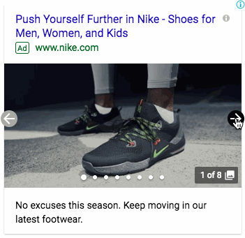
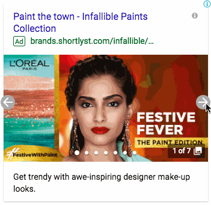
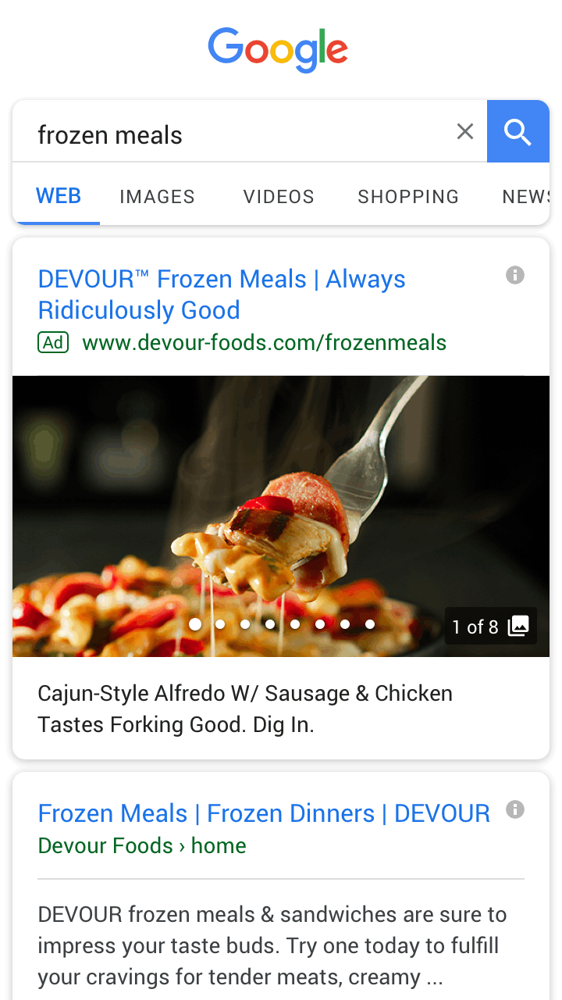
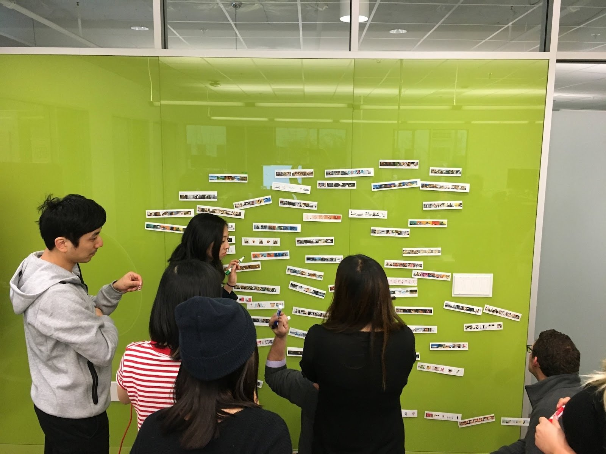
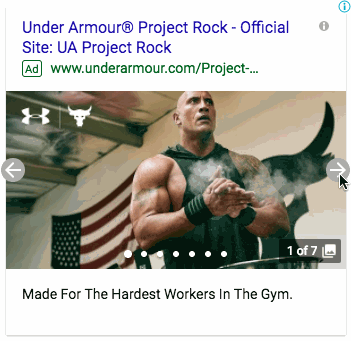
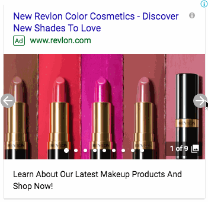
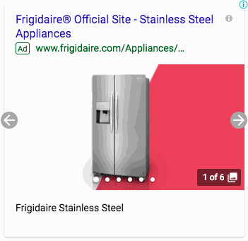

#### One ## stays a heading <!-- .element: class="eyebrow" -->

# Story Ads

## A new chapter in search advertising

---

## Before

Advertisers guessed what we wanted.

## After

Clear rules, with examples.

---

# Two ways to rate an ad

## Quality

How would you rate the ad in terms of quality?

## Interest

How interested are you in the ad?

## Both

Plotted on a 2×2.

---

<!-- .slide: class="cards" -->

# What we learned

## Audience

Digital marketers, not creative directors.

## Detail

Granularity was the key.

## Proof

Rejections fell by 36%.

## Reach

The standards moved to display ads.

---

# Search ads, year by year

## 2017

## 2018

## 2019

---

## Launch

Gallery Ads launched at Google Marketing Live in May 2019.

---

# Five parts: 3 + 2

## One
First.

## Two
Second.

## Three
Third.

## Four
Fourth.

## Five
Fifth.

---

# Fragments

## Always here

Shows at once.

## Whole cell <!-- .element: class="fragment" -->

Heading and text arrive together.

## Just the line

The heading shows at once.

This line comes in later. <!-- .element: class="fragment" -->

---

<!-- .slide: class="dark" data-background-color="theme-1" -->

# A slide in theme-1

---

# Cell backgrounds

<!-- .cell: class="dark" data-background-color="theme-1" -->
## theme-1
The deck's first theme colour.

<!-- .cell: data-background-color="theme-3" -->
## theme-3
The third.

<!-- .cell: class="dark" data-background-color="navy" -->
## navy
Any CSS colour name.

<!-- .cell: class="dark" data-background-image="../petrus/assets/ratings-wall.png" data-background-color="#000" data-background-opacity="0.5" -->
## A photo
Text on top of it.

---

"Open on a team rating ads on a wall."

---

"Six ads, one caption for the group."

---

## In search of a standard

The team rated sample ads on two questions.

Quality, and interest.

---

<!-- .slide: class="prose" -->

## Prose doesn't split

Two headings, one column.

## Still one column

Everything in order, scrolling if it's long.
